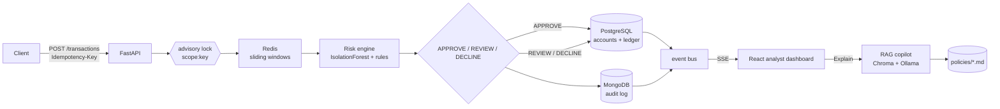

# SentinelPay — design notes

Living document. Phase-scoped decisions get an ADR under `docs/adr/` once they are load-bearing.

## 1. Shape of the system



Postgres owns money and the decision summary. MongoDB owns the rich, append-only audit trail.
Neither is allowed to be the only record of a payment: that asymmetry is what makes reconciliation possible.

## 2. Money is integers

- Every amount is `BIGINT` **minor units** plus a `CHAR(3)` currency. No floats, no `Decimal` in the database, no rounding at rest.
- `accounts.balance_minor BIGINT NOT NULL CHECK (balance_minor >= 0)`. The no-negative-balance rule lives in the schema as well as the service, so a future code path cannot silently create an overdraft.
- `ledger_entries` is append-only. Corrections are compensating transactions, never `UPDATE`/`DELETE`.
- Invariant: per transaction `Σ debit = Σ credit`; globally `Σ signed entries = 0`. Checked when posting and independently verifiable with `scripts/verify_ledger.py`.
- Cross-currency transfers are rejected in Phase 1 (`422 currency_mismatch`). FX is a pricing problem, not a ledger problem, and deserves its own design.

## 3. Idempotency

Contract: `POST /transactions` requires `Idempotency-Key`. Scope is the API client, so two clients cannot collide on the same string.

| Situation | Result |
|---|---|
| new key | transfer executes once, response snapshot persisted, `201` |
| same key, same body hash | stored status + body replayed, `Idempotent-Replay: true`, **no second movement** |
| same key, different body hash | `422 idempotency_key_reuse` |

Implementation, all inside one Postgres transaction:

```sql
SELECT pg_advisory_xact_lock(hashtextextended(:scope || ':' || :key, 0));
```

Then read `idempotency_keys`. If a completed row exists, replay it. Otherwise insert `in_progress`, run the transfer, update to `completed` with the response body, commit.

Why an advisory lock instead of insert-and-catch-unique-violation: 50 concurrent duplicates become **one writer plus 49 replayers**, not 49 retry storms. It is transaction-scoped, so a crashed request releases it automatically — no leaked lock, no expiry sweeper.

The property this buys: the ledger movement and the stored response **commit atomically**. "Charged but no record" and "recorded but not charged" are both impossible by construction, not by cleanup job.

Body hash is SHA-256 over canonical JSON (sorted keys) of the effective payload, excluding headers. Keys expire after 24h.

## 4. Locking order

```python
for account_id in sorted([from_id, to_id]):
    SELECT * FROM accounts WHERE id = :account_id FOR UPDATE
```

Two sequential statements in ascending id order — deliberately **not** `WHERE id = ANY(...) ORDER BY id FOR UPDATE`. Postgres does not guarantee the sort runs before rows are locked in the plan, so the ordered-set form looks correct and is not. With a deterministic order, A→B and B→A always acquire in the same sequence and cannot deadlock.

The balance check happens *while holding the lock*, never before (TOCTOU).

Pessimistic row locks rather than optimistic retries or `SERIALIZABLE`: the negative-balance invariant is non-negotiable, and a short queue beats a retry storm under contention.

## 5. Velocity store (Phase 2)

One Redis sorted set per user: `score = event epoch ms`, `member = txn_id:amount:country:merchant`. A single Lua script returns count, amount sum, distinct countries and distinct merchants for the 1m / 10m / 1h windows and trims the set in one round trip.

- `maxmemory-policy noeviction`: evicting velocity counters silently blinds the fraud layer. If Redis fills up we want a loud error, not quiet blindness.
- O(N) over a user's 1h window. Fine at demo scale; the production answer is bucketed counters or RedisTimeSeries, and it is written down here rather than discovered later.

## 6. Failure modes

| Failure | Behaviour | Rationale |
|---|---|---|
| Redis down during scoring | degrade with `velocity_degraded=true`; force `REVIEW` above an amount floor; never silent `APPROVE` | the attacker who takes Redis down must not get a free pass |
| Mongo down after commit | money is already committed; return `503`; client retries with same key → replay path returns the original answer and re-attempts the audit upsert (idempotent on `txn_id`) | availability of the ledger must not depend on the audit store |
| audit doc missing | `scripts/reconcile_audit.py` finds Postgres transactions with no Mongo doc | the asymmetry is detectable, therefore fixable |
| request dies mid-flight | advisory lock released on rollback, key row never committed → retry executes exactly once | |
| multiple API workers | in-process event bus duplicates SSE across workers; Phase 5 moves the feed to `LISTEN/NOTIFY` | dev-only simplification, documented |
| model artifact / feature order drift | startup fails fast on mismatch between `model_meta.json` and the feature builder | silent feature skew is the classic silent-failure mode of ML in prod |

## 7. Risk decisioning (Phase 2)

- IsolationForest on synthetic data (normal traffic + card testing + geo-hopping + amount spikes). Score is mapped to 0–1 and documented as **not a probability**.
- The feature contract includes a derived `log_amount_vs_prior_avg_10m`: the current amount against the 10-minute window's prior average. Without it the model cannot see a cash-out at all — a spike is a *contrast with history*, not an absolute size, and a model served only raw window sums scored spikes at 0.19 vs normal 0.019 (indistinguishable). With the ratio: 0.30–0.34 median and every shape separated. `python -m ml.train` refuses to write an artifact that fails this separation check.
- Deterministic rules layer with stable ids (`R_GEO_HOP_3_60S`, `R_CARD_TESTING`, `R_AMOUNT_SPIKE`, …) so an explanation can cite something specific.
- `decision = max(model band, rule floor)`; thresholds are env-tunable (`RISK_APPROVE_MAX`, `RISK_REVIEW_MAX`).
- `REVIEW` holds funds — no ledger movement until an analyst approves. Without that, the dashboard's approve button would do nothing real.
- Decision + features + rules + model version are written to Postgres *and* MongoDB.
- An attempt is recorded even when declined: the attempt is the signal, and card testing is exactly many unremarkable-looking requests.

## 8. RAG copilot (Phase 4)

- 9 synthetic policy docs with frontmatter (`id`, `title`, `jurisdiction`, `effective_date`), chunked on headings.
- Chroma persistent client, embedded in the API process, local ONNX MiniLM embeddings — no API key, no torch.
- LLM behind a `Protocol`: `NullLLM` (deterministic, offline, used by tests and CI) and `OllamaLLM` (native Ollama, `qwen2.5:3b-instruct` on the 3050 Ti).
- Grounding is enforced by a validator, not by prompt wording: every cited chunk id must be in the retrieved set, every number must appear in the transaction features or the retrieved text, otherwise the answer is replaced with "insufficient evidence".

## 9. Local topology and its constraints

Hardware: Ryzen 7 4800H, 15.4 GB RAM, RTX 3050 Ti (4 GB VRAM), Windows 11.

- WSL2 VM capped at 6 GB via `~/.wslconfig` so datastores cannot starve the host.
- Ollama runs natively on Windows (GPU passthrough into WSL2 on laptop dGPUs is unreliable).
- Chroma runs embedded rather than as a container (~400 MB saved).
- `qwen2.5:3b-instruct` Q4_K_M (~2 GB) fits fully in VRAM; a 7B would spill to CPU and eat RAM we do not have.
